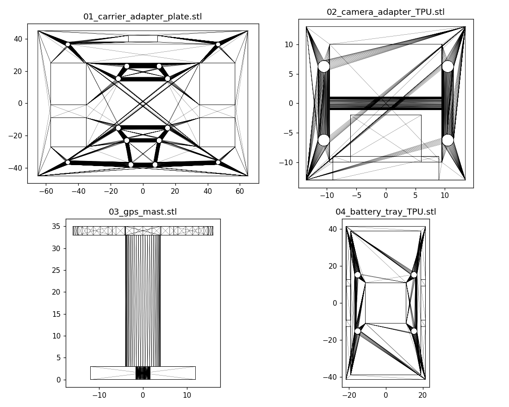

# FlyTwin Hardware — 5-inch Prototype (Route B)

Hardware for the FlyAgent / FlyTwin prototype drone: a 5-inch quadcopter carrying a
PX4 flight controller and an RK3576 companion computer. This repo is the single source
of truth for **how the prototype is built**, so the software team (simulation, onboard
software) and the hardware team stay in sync.

> **As-built update (2026-11-21):** Airframe #1 has been reassembled with the
> **NxtPX4v2 flight controller above the MicoAir 50A ESC** on a custom printed
> eight-hole adapter, an ArmSoM CM5/CM5-IO on a raised V3 carrier, adjustable
> front camera and four printed landing legs. The physical build is documented
> in [the English assembly guide](docs/assembly.md), [photographs](build-log/2026-11-21_airframe1_rebuild/notes.md)
> and [interactive 3D assembly viewer](viewer/index.html). **Vibration isolation
> is unverified; compute BEC is not installed; TEL1 telemetry and PX4 v1.16.2
> reflight are pending.** Older design pages describe the reference build,
> not necessarily the actual aircraft. See [as-built status](docs/as-built-status.md).



## What is in here

| Path | Contents |
|------|----------|
| [docs/architecture.md](docs/architecture.md) | How the aircraft works: layer stack, power tree, data links, vibration isolation, RF/magnetic layout, mass budget, design decisions |
| [docs/assembly.md](docs/assembly.md) | As-built English assembly guide with photographs and mechanical schematics |
| [docs/wiring.md](docs/wiring.md) | Every connector and pin mapping |
| [docs/px4-firmware-and-params.md](docs/px4-firmware-and-params.md) | Firmware version, flashing, migration from the vendor build, parameter set |
| [docs/as-built-status.md](docs/as-built-status.md) | Differences between docs and the real aircraft; change log |
| [bom/bom.md](bom/bom.md) | Bill of materials as actually purchased, with status |
| [mounts/](mounts/) | 3D-printed parts: STL files, parametric source, print settings |
| [viewer/index.html](viewer/index.html) | Interactive 3D assembly viewer (step-by-step, exploded view, click a part) |
| [viewer/parts.html](viewer/parts.html) | 3D viewer for the printed-part STL files |
| [params/](params/) | PX4 parameter files exported from each aircraft |
| [build-log/](build-log/) | Dated build photos and notes |

### Opening the 3D viewers

`viewer/index.html` works by double-clicking it. `viewer/parts.html` loads the STL files
over HTTP, so serve the repo first:

```bash
python -m http.server 8000      # from the repo root
# then open http://localhost:8000/viewer/parts.html
```

`viewer/index.html` is the reviewed self-contained as-built viewer (embedded meshes);
`viewer/parts.html` loads the standalone STL files and requires HTTP.
Both pages also work from GitHub Pages if it is enabled for this repo.

## The aircraft in one table

| Subsystem | Part |
|-----------|------|
| Frame | TBS Source One V5.1, 5-inch, 6 mm arms |
| Motors | iFlight XING2 2207 1855KV ×4 |
| Props | Gemfan 51466 tri-blade |
| Flight stack | MicoAir NxtPX4v2 50A stack: NxtPX4v2 flight controller (STM32H743, dual BMI088, 20×20 mm) + MicoAir 50A 4-in-1 ESC |
| Flight firmware | PX4 **v1.16.2**, mainline target `hkust_nxt-dual` (migrating from the vendor build `micoair743-v1.14.3`) |
| Companion computer | **Airframe #1: ArmSoM CM5 + ArmSoM CM5-IO** (RK3576). Earlier reference design specified BPI-CM5 Pro; confirm the exact installed board before wiring. |
| Camera | IMX219 120° (MIPI CSI) |
| GPS + compass | Holybro Micro M10 |
| Radio | RadioMaster RP1 ELRS 2.4 GHz receiver, RadioMaster Pocket transmitter |
| Battery | Tattu R-Line 4S 1550 mAh 95C (LiPo) |
| Companion power | **Planned** 4S → 12 V BEC to IO board; **not installed** on Airframe #1 |

This is a **transition prototype**. The FlyAgent AIO carrier board (RK3576 module +
integrated H743 flight controller) will replace the IO board, the MicoAir flight
controller and the BEC; the frame, motors, ESC and battery carry over.

## How to keep this repo in sync

- **Hardware changes on the aircraft** → update the relevant doc *and* add a line to the
  change log in [docs/as-built-status.md](docs/as-built-status.md). If you are not sure
  how to write it up, a photo in `build-log/` plus one line in the change log is enough.
- **PX4 parameter changes** → export from QGroundControl and commit to `params/`
  (file naming in [params/README.md](params/README.md)). Never edit parameters without
  committing the before/after files.
- **Printed part changes** → commit the new STL (and STEP/source if you have it) to
  `mounts/`, update the table in [mounts/README.md](mounts/README.md).
- Flight logs (`.ulg`) do **not** go here; they go to the data repository.

## Safety

- Props **off** for every bench session, firmware flash, parameter change and motor test.
- Charge LiPos in a fire-safe bag; never leave charging unattended.
- First flights of any change are tethered (see [docs/assembly.md](docs/assembly.md#4-mechanical-and-electrical-checks-before-powered-testing)).
- Users are responsible for registration, airspace and local regulations. At ~700 g this
  aircraft requires registration in most countries.

## License

Hardware design files: CERN-OHL-P v2. Documentation: CC BY 4.0. (License files to be added.)