# Assembly guide — Airframe #1 (as-built revision)

**FlyTwin / FlyAgent · TBS Source One V5.1 · 28 November 2026 · Draft for hardware review**

Current configuration, measurements, evidence and open checks are in the
[as-built status](as-built-status.md). The 2026-11-21 photos predate later corrections.
Use the [36-step offline viewer](../viewer/index.html) for the part-by-part visual
tutorial; its meshes are not confirmed to align with the physical airframe.

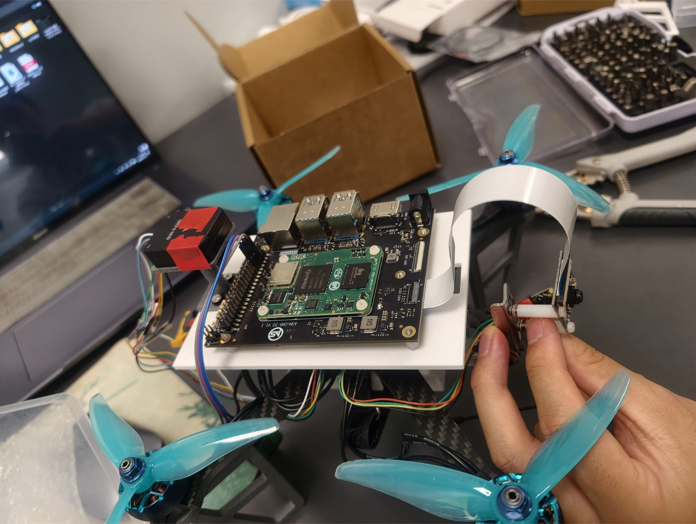

*Figure P1 — Airframe #1 with CM5 carrier and front adjustable camera; photograph shows an inspection/handling configuration, not a flight-ready configuration.*

## 1. Scope and components

| Subsystem | Airframe #1 as observed | Source / drawing basis |
| --- | --- | --- |
| Airframe | TBS Source One V5.1, five-inch Quad X | Simplified in viewer |
| Propulsion | 4 × iFlight XING2 2207 1855KV, four Gemfan 51466 props | Photographs; motors/props schematic in viewer |
| Flight stack | MicoAir 50A four-in-one ESC below MicoAir NxtPX4v2 FC | Actual assembly photos |
| FC/ESC adapter | Printed **40 × 40 × 1.5 mm** plate; 20 mm inner pitch, 30.5 mm outer pitch | Supplied eight-hole STL; builder reports it is installed |
| Upper carrier | Printed **90 × 137 × 3 mm** V3 plate | Actual STL |
| Upper plate position | Carbon top plate removed; the V3 printed carrier occupies this position | Builder statement; load transfer not independently checked |
| Companion | **BPI-CM5 Pro 4+32G WiFi module** (package marking) with separately purchased **ArmSoM CM5-IO** on four raised supports | Builder identification; UART and power are unverified |
| GPS / camera | Holybro Micro M10 GPS on printed mast; IMX219 on adjustable metal hinge | Photographs; GPS mast STL |
| Landing gear | Four printed V7 legs, each nominally 80 mm tall | Actual V7 STL |
| Battery support | Underslung printed battery tray and strap | Actual STL; battery not fixed in model |

The builder identifies the five supplied printed STL revisions as installed: [carrier V3](../mounts/stl/01_carrier_adapter_plate_V3.stl), [FC/ESC adapter](../mounts/stl/05_esc_plate_40x40x1p5_outer4p1_R1.stl), [GPS mast V2](../mounts/stl/03_gps_mast_v2_rounded_rect.stl), [battery tray](../mounts/stl/04_battery_tray_TPU.stl), and [landing leg V7](../mounts/stl/landing_foot_v7.stl). There are **8 part instances**: 1 + 1 + 1 + 1 + 4. Their mesh alignment with the physical airframe has not been independently checked. Print material and individual fastener length are not established by the STL files; **do not infer material merely from a filename**.

## 2. Center-stack geometry and mounting datums

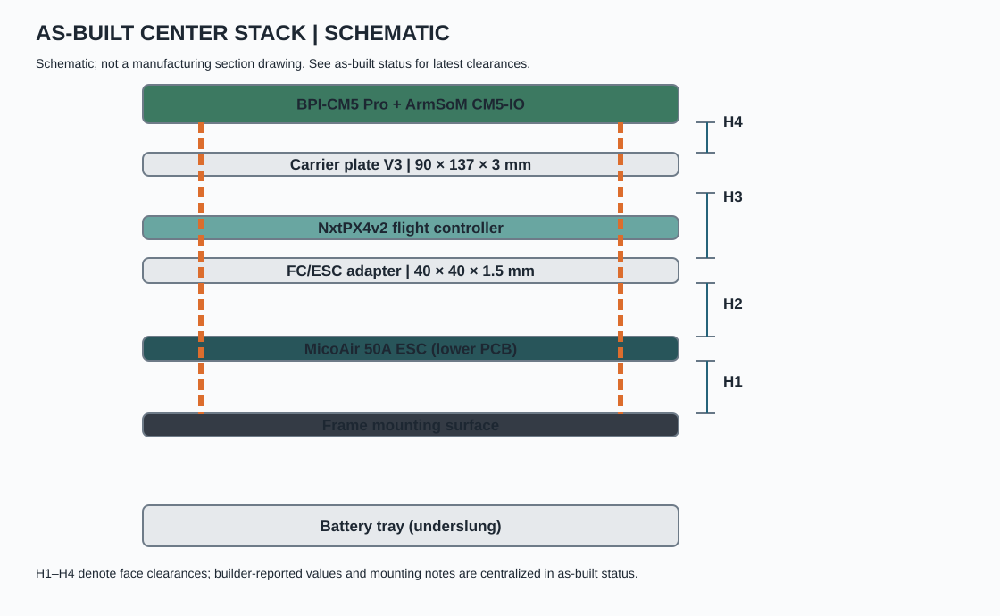

*Figure 1 — As-built vertical order and four user-measured clearances. Printed plates have their native dimensions; other components and fasteners are schematic.*

The latest H1–H4 clearances, their face definitions and source are in
[as-built status](as-built-status.md). The FC lies within H3 above the adapter. The four
outer fasteners continue from the frame through the ESC/adapter chain to the V3 carrier.

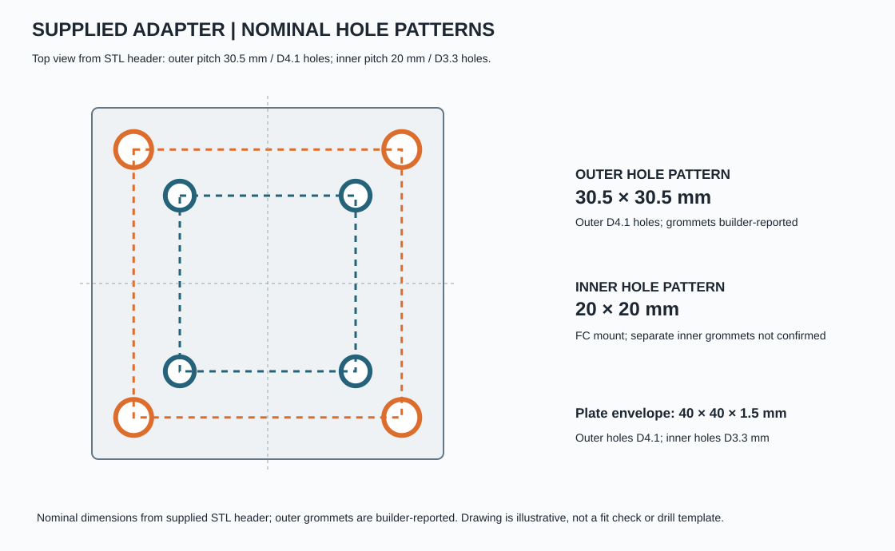

*Figure 2 — Nominal adapter geometry from the supplied eight-hole STL. Its hole pitches and diameters are identified in the STL header. This drawing is explanatory, not a drilling template; check the actual hardware rather than forcing screws.*

**Mounting limitation.** See [as-built status](as-built-status.md) for the current mount
description and the unresolved inner-hole grommet request. Check clamp/contact paths and
PX4 vibration data before claiming effective FC isolation.

## 3. Assembly sequence

**Safety prerequisite:** Disconnect all batteries. **Remove the four propellers before assembly, soldering, firmware changes, wiring checks or motor tests.** Photograph each step before covering it with the next layer if further reconstruction will be needed.

### Step 1 — Carbon frame, arms and motors

1. Assemble the four carbon arms and lower central plate as supplied for the Source One V5.1. Airframe #1's carbon top plate has been removed; the V3 printed carrier occupies its position. Check the actual fit and load path before powered use.
2. Install the four XING2 motors with correctly sized screws; verify that no screw touches motor windings.
3. Route three motor leads from each motor to the central ESC; keep wires outside propeller arcs and away from sharp carbon edges.
4. Identify the aircraft **nose** as the end carrying the adjustable camera. Use the same forward reference across photos, viewer and PX4 orientation checks.

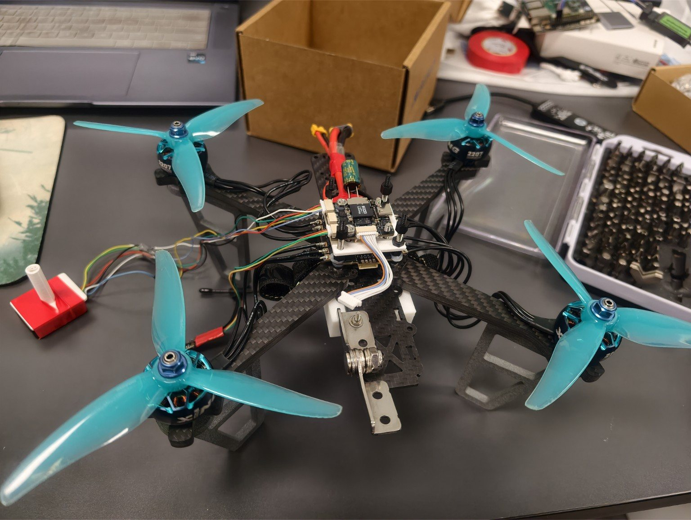

*Figure P2 — Carbon-frame / motor arrangement with upper carrier temporarily removed.*

### Step 2 — Lower ESC and continuous outer fasteners

1. Insert the four outer mounting screws through the carbon frame at the **30.5 × 30.5 mm** pattern.
2. Position the outer grommets and lower spacing using the actual hardware; see [as-built status](as-built-status.md) for the builder-reported arrangement.
3. Place the 50A ESC as the **lower PCB**, with sufficient component and solder-joint clearance.
4. Connect or inspect the motor leads and battery power lead. Check polarity and clearance of all electrical joints and components.
5. Re-check that the full fastener stack does not bend the ESC PCB or compress an exposed electrical component.

**Existing electrical wiring:** The original repository specifies the battery lead, ESC-to-FC harness and polarity checks in [wiring.md](wiring.md). Use that page for signal identities; photographs alone are not a reliable pinout. The XT30/BEC branch is **not evidence that the BEC is installed**.

### Step 3 — Printed 8-hole adapter and NxtPX4v2 FC

1. Position the builder-reported grommets at the adapter's **outer holes** on the ESC's outer fasteners, then fit the spacer/nut stack without loading electrical components.
2. Seat the **40 × 40 × 1.5 mm eight-hole adapter** (`05_esc_plate_40x40x1p5_outer4p1_R1.stl`) on its **30.5 mm outer pitch**.
3. Mount the NxtPX4v2 FC at the adapter's **20 mm inner pitch** using the actual hardware. The builder reports silicone washers above the FC at these inner holes. The separate inner-hole FC grommets requested are not confirmed fitted; do not treat the washers as satisfying that request.
4. Keep the FC USB-C socket and microSD access clear. Install the matching original ESC-to-FC cable and verify connector orientation against the hardware, not cable colour.
5. Check clearance from the ESC, FC solder joints, all screw ends and the upper carrier supports. Do not allow the adapter or nuts to touch live pads.

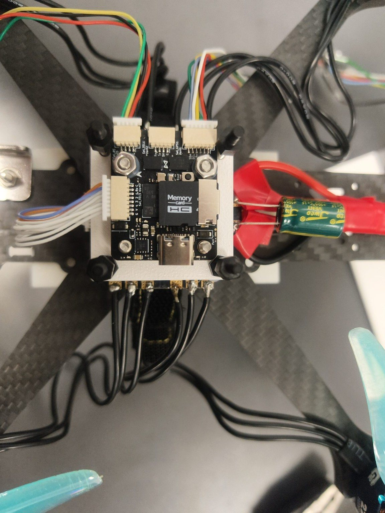

*Figure P3 — 2026-11-21 photo of the FC above an earlier adapter version. It does not confirm the later grommet and washer arrangement described in the current status.*

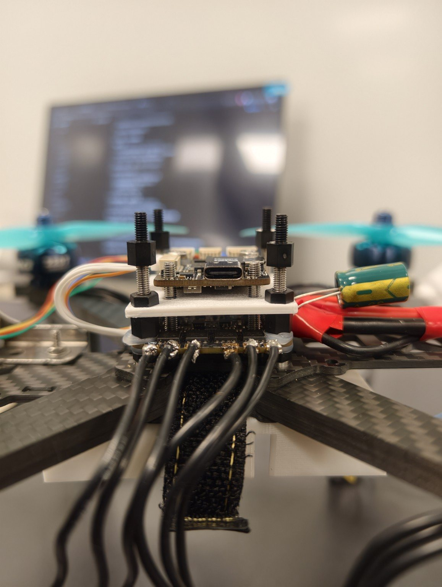

*Figure P4 — 2026-11-21 side photo showing the FC, printed adapter, ESC and outer mounting screws; the later H1–H4 values and mounting updates are not visible here.*

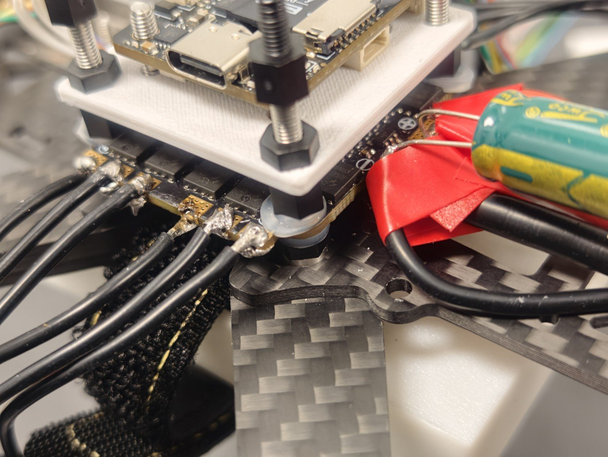

*Figure P5 — 2026-11-21 close-up of the earlier assembly. Confirm current fit and contact paths on the aircraft; this photo does not establish effective vibration isolation.*

### Step 4 — Upper through-couplers and V3 carrier

1. Continue the four **outer** fasteners upward using the installed threaded extension couplers.
2. Position the large **90 × 137 × 3 mm** V3 carrier on the four center-stack supports; the builder reports it occupies the removed carbon top plate's position.
3. Fit the upper retaining nuts. Confirm the carrier is level and does not press on the FC, its connectors or the CSI ribbon.
4. The carrier provides mounting points for the CM5-IO board and the GPS mast. Preserve the front cable slot and the board's service access.

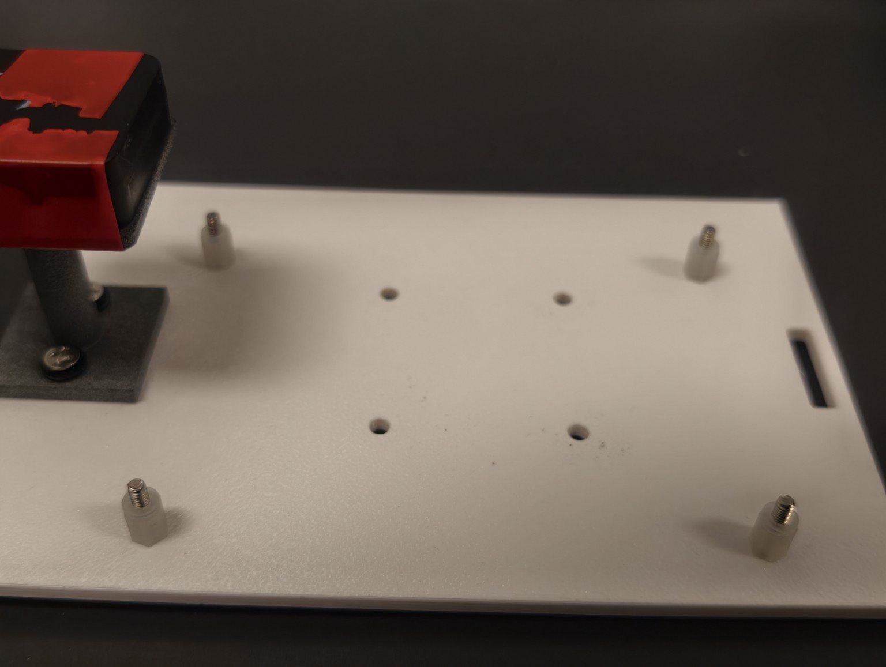

*Figure P6 — V3 carrier shown without the IO board. The internal fastener pattern belongs to the center stack; four outer posts raise the IO board.*

### Step 5 — BPI-CM5 Pro module and ArmSoM CM5-IO board

1. Install the **BPI-CM5 Pro 4+32G WiFi module** on the separately purchased **ArmSoM CM5-IO** board using the actual compatible fixing hardware; do not support a module only by its board-to-board connectors.
2. Mount the IO board on **four separate risers** on the V3 plate.
3. Confirm access to the IO board's USB, Ethernet, DC input and CSI connectors.
4. Leave enough free length for the camera FPC through the carrier slot. Keep cables clear of props and screw ends.
5. The **onboard 12 V BEC is not installed**. Do not label the compute board as operational from flight-battery power until a separate loaded power test is completed.

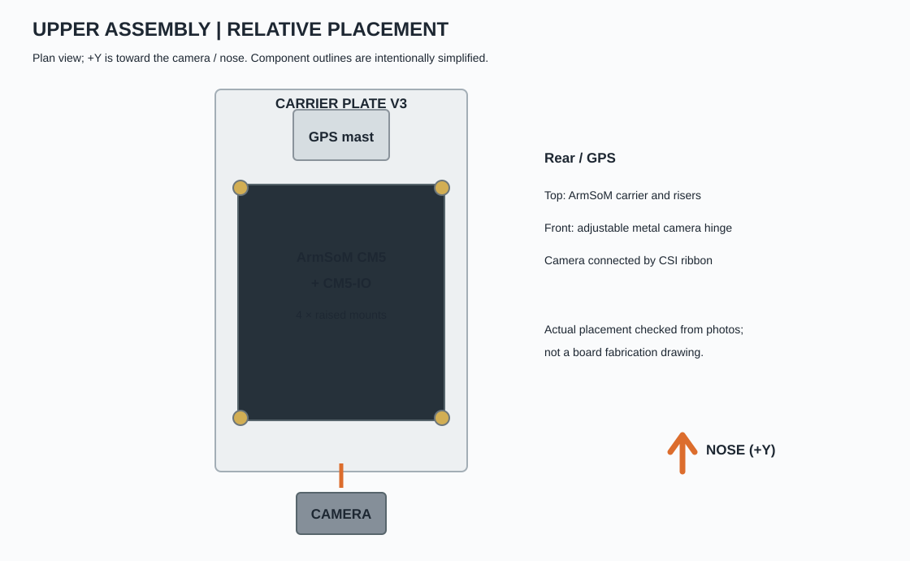

*Figure 3 — Simplified upper-carrier layout. The printed V3 geometry is authoritative for its outline/holes; schematic electronic-board outlines do not constitute fabrication data.*

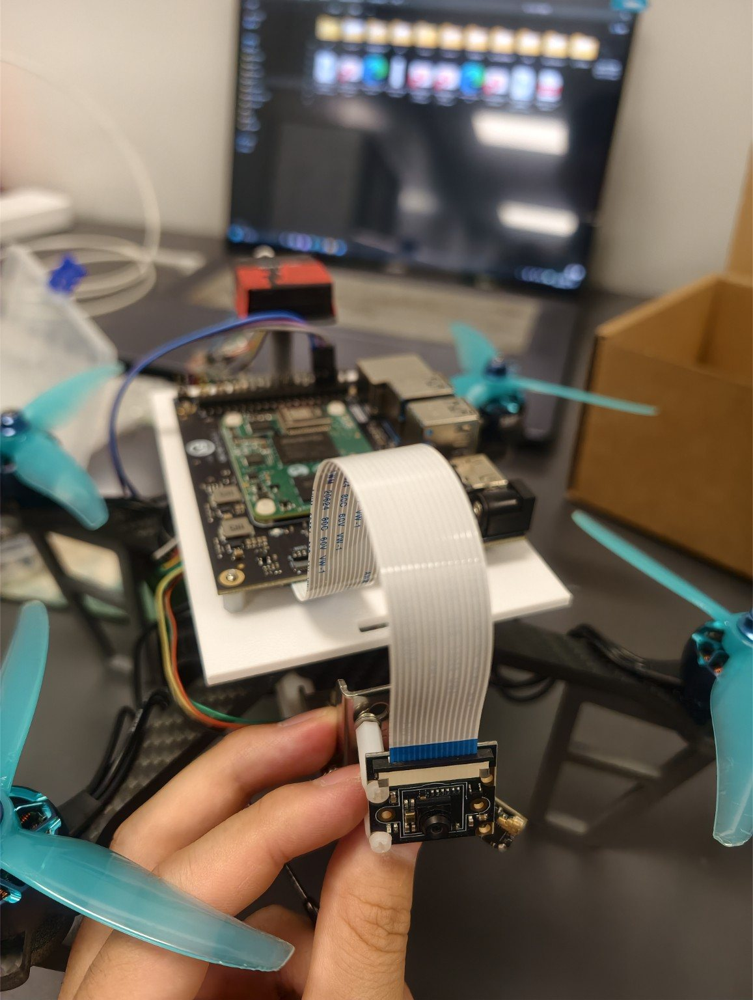

*Figure P7 — 2026-11-21 photo of the compute assembly above the V3 carrier; the module's package marking and separate IO-board purchase are recorded from the later builder update.*

### Step 6 — Rear GPS mast and GPS module

1. Fix the actual **35 mm tall printed GPS mast V2** to the rear mounting area of the V3 carrier.
2. Attach the Holybro Micro M10 module to the mast platform; preserve the forward arrow direction.
3. Route the GPS cable to the flight-controller GPS connector without tension or contact with motor wires.
4. Use the actual verified cable re-pinning, **not** an assumed connector pin order. The original [wiring guide](wiring.md#gps1) notes a mismatch between GPS and flight-controller cable pin arrangements.

### Step 7 — Adjustable forward camera

1. Fix the **metal tilting hinge bracket** at the front carbon-plate extension using the observed screws/standoffs.
2. Fasten the IMX219 camera board to the bracket using the two white printed spacing sleeves and through-screws.
3. Adjust the pitch angle so the lens has a forward view without the frame or props obstructing it; verify lock-nut tightness.
4. Route the CSI FPC with a smooth bend and strain relief to the CM5-IO camera connector. Do not twist, pinch or sharply crease the ribbon.

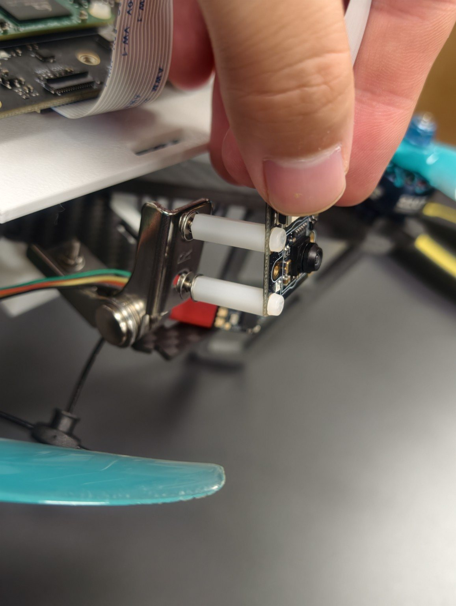

*Figure P8 — Adjustable hinge, white spacing sleeves and camera board; the tilt setting is adjustable, not a fixed 20-degree CAD datum.*

### Step 8 — Underslung battery tray and four V7 legs

1. Fit the actual printed **45 × 81.5 × 15 mm** battery tray beneath the central frame using the existing mounting hardware and battery strap.
2. Inspect the strap routing and clearance to motor wires, camera bracket and the ground.
3. Attach four V7 landing legs under the motor arms, keeping the supplied motor hole pattern and ensuring that mounting screws cannot reach motor windings.
4. Confirm all four feet are firmly seated and the aircraft rests without rocking. Validate printed-part cracking and fatigue separately; STL geometry alone does not prove print strength.
5. The tray is shown **empty** in the current assembly viewer. A LiPo is a removable flight item, not a permanently installed component.

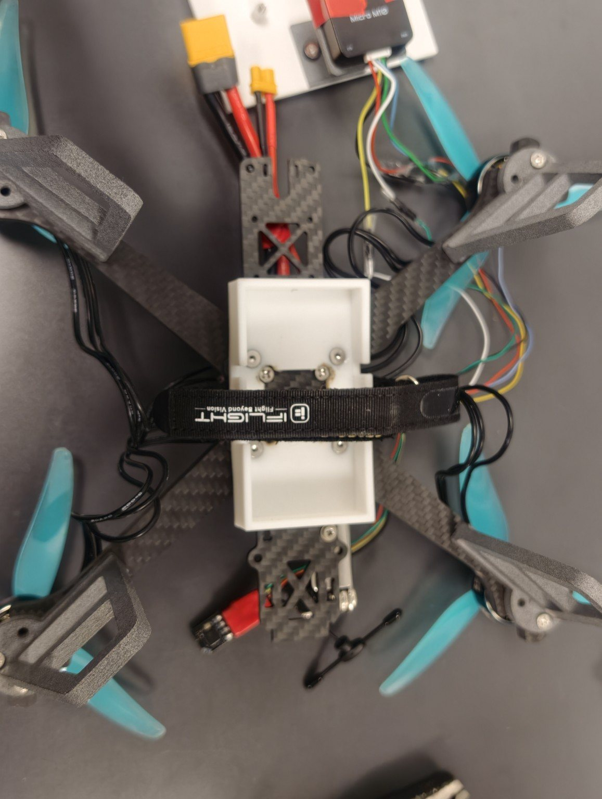

*Figure P9 — Underside showing the battery tray, strap, four motor-arm feet and central carbon structure.*

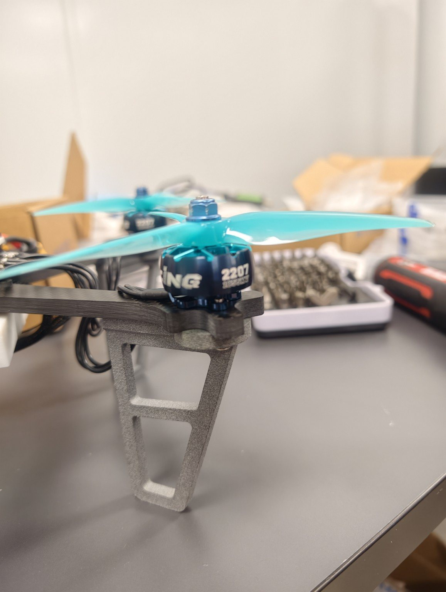

*Figure P10 — Installed V7-style landing leg under a motor arm.*

### Step 9 — Propellers: illustration only

The 3D viewer displays Gemfan propellers to resemble the airframe photos. **Do not install propellers for any of the electrical, firmware, calibration or motor-direction tests above.** Before a future flight, verify the actual PX4 motor map, spin directions, propeller orientation and all applicable operating checks independently.

## 4. Mechanical and electrical checks before powered testing

- [ ] Battery disconnected and **all propellers removed**.
- [ ] Four ESC/FC outer through-fasteners are secured; **the ESC PCB is not acting as a bent load-bearing spacer**.
- [ ] Inner FC hardware is secure; screw tips and washers clear circuitry, and the requested separate inner-hole grommets have been fitted or explicitly resolved.
- [ ] Silicone washers do not bridge to bare solder or power pads; metal paths and vibration coupling have been assessed.
- [ ] Carrier, GPS mast, camera hinge and all four V7 legs are rigidly retained where intended.
- [ ] CM5/IO board is elevated without board flex; connectors, ribbon and antennas have strain relief.
- [ ] No battery/ESC power connector is shorted or reversed; use a multimeter for polarity and continuity checks.
- [ ] Original ESC-to-FC harness and GPS/RC cable pinouts are verified against actual silk-screen markings.
- [ ] BEC remains **not installed**, and TEL1 serial telemetry remains **not verified** in the as-built record.
- [ ] PX4 v1.16.2 output mapping, RC, sensors, GPS, battery measurement and failsafes are checked **with props removed** before planning a controlled reflight.

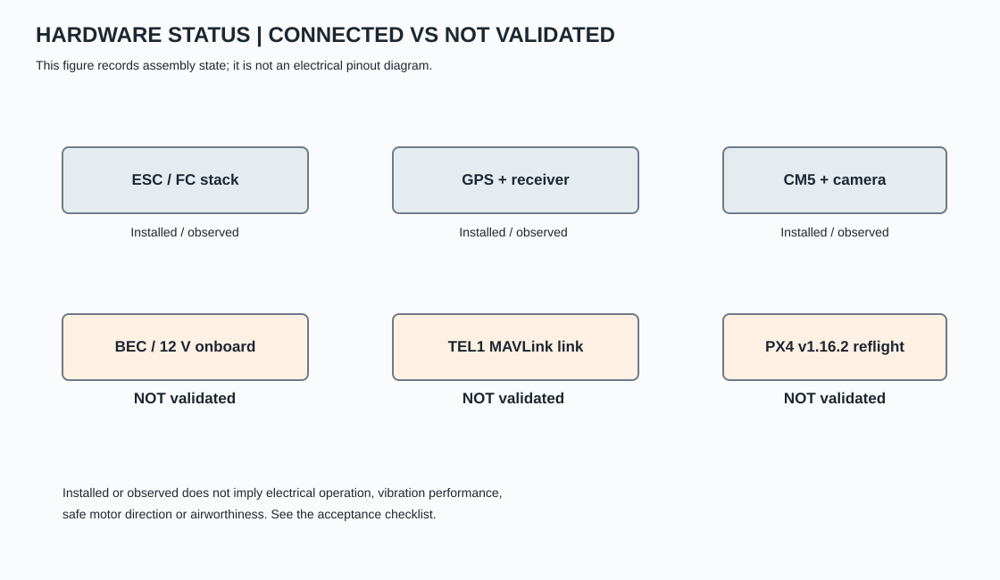

*Figure 4 — Actual assembled hardware is separated from unfinished power, UART and flight checks.*

## 5. Repository records and pending acceptance

| Record | Location | Current status |
| --- | --- | --- |
| Current state and deviations | [as-built-status.md](as-built-status.md) | Latest builder corrections and open checks |
| Bill of materials | [bom/bom.md](../bom/bom.md) | Current parts identification; prices remain historical planning values |
| Printed models | [mounts/README.md](../mounts/README.md) | Five current STL files; physical fit and print material are unverified |
| Photos and notes | [build-log](../build-log/2026-11-21_airframe1_rebuild/notes.md) | 2026-11-21 photo record; later state is separated and labeled as builder-reported |
| PX4 parameters | [params/](../params/) | 2026-11-12 file supplied; export a post-check file after revalidation |
| Flight logs | Separate data repository, **not this hardware repo** | Archive a `.ulg` only after a real flight |
| TEL1 / 12 V BEC | [wiring.md](wiring.md) | Record measured UART pin/device/baud and BEC results after verification |

**Open acceptance items:** (1) resolve the requested FC inner-hole grommets and verify load paths and vibration, (2) complete PX4 v1.16.2 props-off revalidation and a controlled reflight, (3) install and validate flight-battery-to-CM5 power, and (4) demonstrate PX4 TEL1/MAVLink telemetry on the actual companion computer.

---

**Documentation scope:** The dated photos, later builder-provided corrections and five supplied STL files have different evidence dates; see [as-built status](as-built-status.md). Simplified drawings and viewer geometry are not machining drawings, installation torque references, verified fits or evidence of flight certification. Recheck connector pinouts and motor direction on the physical hardware before use.
