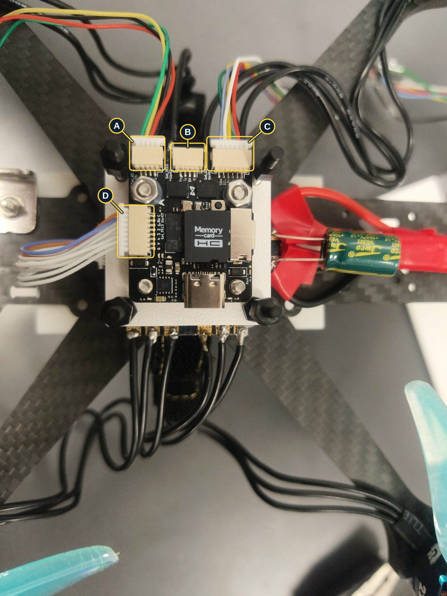

# Flight controller connector photo

This reference photo is from the 2026-11-21 build log. A–C mark the three sockets along the board’s upper edge, left to right; D marks the white plug on the left edge. The microSD card is near the board centre and USB-C is at the lower edge.

*The photo is embedded unchanged beneath the overlay. [Open the original JPEG](../build-log/2026-11-21_airframe1_rebuild/photos/03_flight_stack_top.jpg).*

| Mark | Position | Visible wire colours |
|---|---|---|
| **A** | Upper edge, left plug | Green, yellow, orange/red |
| **B** | Upper edge, middle socket | No lead connected in this photo |
| **C** | Upper edge, right plug | Blue, white, yellow, orange/red, green |
| **D** | Left-edge plug | White/light grey, blue, tan/brown |

Wire colours are photo-orientation cues only; they do not identify pin 1 or electrical functions. Check the board silkscreen and [wiring guide](wiring.md) for pin mappings.
